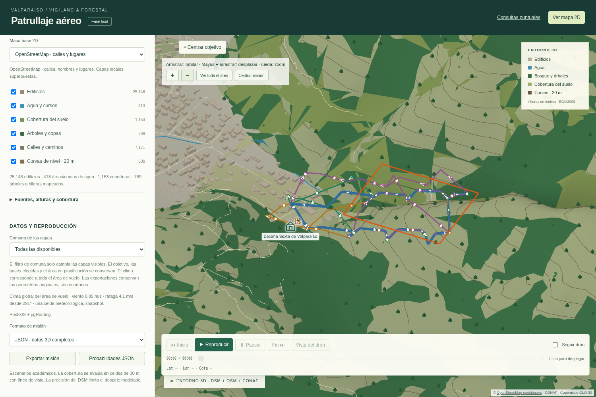
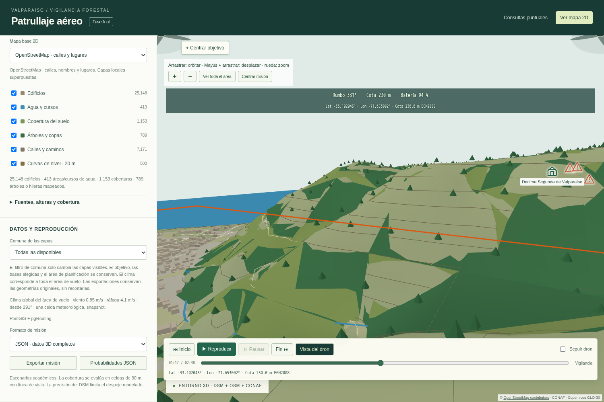

# Resultados de las mejoras 3D

La aceptación completa de esta versión pasó sobre `dbtest/ruteo_test`, una base
desechable. La huella del código del host, de la imagen probada y del benchmark
coincide: `c93cdd7230d8d91e8342ce508c6f3dc4a62f676af901d703e5e530582af40139`. El commit base es `301c676fe957ea2a94f13ead965c8d0aa1c12bc8`;
la implementación permanece en el árbol de trabajo, sin publicación automática.

| Verificación | Resultado |
|---|---:|
| Python e integración PostgreSQL/PostGIS/pgRouting | 188 pruebas |
| Node | 30 pruebas |
| Navegador, siete grupos de aceptación | 121 comprobaciones |
| Fallos, errores y omisiones | 0 |

El [manifiesto de evidencia](../evidencia/mejoras_3d_2026-11-07/manifest.json)
identifica los archivos y la huella exacta. Los logs y exportaciones completas
permanecen en `evidencia/local/`; sus hashes se conservan sin duplicar esos
archivos grandes dentro del runtime. La [descripción técnica](MEJORAS_3D.md)
incluye los contratos, las responsabilidades de los cuatro subagentes y el
cambio geométrico del fixture de recarga.

Para reproducir ese caso desde la interfaz, importar el
[objetivo de recarga](../evidencia/mejoras_3d_2026-11-07/objetivo_recarga.geojson),
elegir la base 104, batería útil de 190 s y la estación 104. La reserva de reporte
de 60 s se mantiene; no es un aumento de capacidad para forzar una solución.

Se verificaron las cotas canónicas compartidas entre planificación y simulación,
las cuatro técnicas con el nuevo perfil, la reserva de reporte y una recarga
con **190 = 130 + 60 s**. El objetivo horizontal usa el máximo conservador del
DSM y su malla visual más 30 m, sin inventar elevación en NoData. La topografía
conserva sus alturas y paleta.

Las exportaciones JSON y GeoJSON coinciden con el vuelo. GeoJSON conserva
longitud/latitud en la geometría 2D y las alturas EGM2008 en atributos. Se
comprobaron nombres e iconos, rutas de ancho estable y flechas, zoom, coordenadas,
hélices y POV con geometría visible. El seguimiento produjo
**64 cambios de posición del mapa
en 1,2 s** en la prueba, frente a los saltos anteriores cada 250 ms. Es una
medición de esa ejecución, no una garantía de FPS en cualquier equipo.

La preparación repetida de tres misiones con la misma escena/perfil, en un
proceso nuevo y sin solvers concurrentes, pasó de
**65.99 s** en frío a una mediana de
**6.35 s** al reutilizar geometría:
**90.4 % menos**. Esto mide
preparación, no el tiempo total de todos los algoritmos.

Las respuestas resumidas midieron 51,673 bytes para el mapa y
187,086 para la misión. También se comprobaron diagnóstico,
ambas comunas, ETag y HTTP 304; todas las respuestas medidas quedaron bajo 1 MiB.

La validación es local y reproducible con `./main probar`. El workflow de
GitHub Actions está configurado; no se acredita una ejecución remota de estos
cambios mientras permanezcan sin publicar. El video continúa excluido.
La web actualizada responde en http://127.0.0.1:18083 y conserva la publicación
`2e6808a3-a8c3-5543-a051-cf5f4ac1c5d0`; la base original no se recargó.
Se conservan las limitaciones académicas y de fuentes descritas en la matriz;
esta aceptación no certifica operaciones reales de vuelo ni una calificación.
