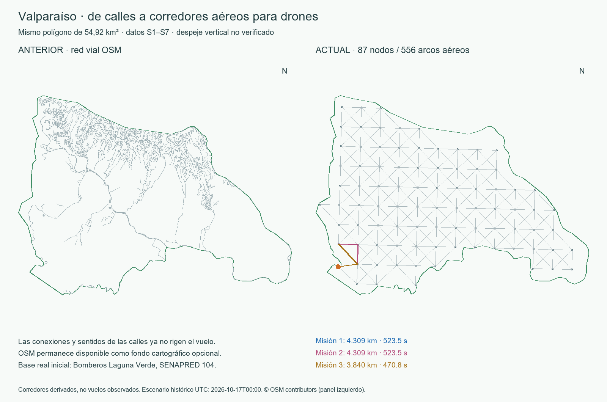

# Implementación aérea del plan y comprobaciones

17 de octubre de 2026. La aplicación se adaptó al objetivo original: simulación
de misiones de drones de vigilancia forestal. Se retiró la dependencia de calles
para el cálculo aéreo, conservando el modelo vial y sus datos como antecedentes.

## Estado entregado

- Inicio y destino elegibles por clic, coordenadas o instalación real; intercambio
  y restablecimiento de extremos. No se exige cercanía a una calle.
- Trayecto de solo ida o misión con observación y regreso al inicio. Se muestran
  hasta tres alternativas y sus distancias, tiempos y exposición.
- Bloqueos circulares o poligonales explícitamente simulados; resolución y
  replanificación desde nodos con tiempo consumido y fase de misión.
- Datos S1-S7 del informe, nueve salidas ETL y cargadores tipados, Docker y main.
- **Simulador académico: despeje vertical no verificado.** No se incorpora un
  inventario de obstáculos ni una autorización de vuelo.

La instancia de entrega está habilitada en **http://127.0.0.1:18081**. Los detalles
de contratos, unidades y API están en [DATOS_AEREOS.md](../../docs/DATOS_AEREOS.md).



## Geografía y base

Se preserva el GeoJSON exacto del usuario, SHA-256
`7d3a0472f2e7fdde88d6316f89c31d6da50914e06cabb6bf8bd270ce54c905b7`.
El área proyectada es **54,920709 km²**, no la totalidad administrativa de la
comuna. Todos los nodos y segmentos completos quedan dentro del límite WGS84.

La red nueva contiene **87 nodos y 556 arcos dirigidos**, una componente débil y
una fuerte. Se genera mediante malla UTM de 800 m y vecindad simétrica de hasta
ocho nodos a 1.500 m, con inclusión completa de segmentos. No se fuerzan uniones.
Se diferencia la navegación en todo el AOI de los objetivos situados en
vegetación de interés. Este cambio respecto del informe evita convertir suelo
urbano o ausencia de vegetación en una barrera aérea automática.

La base candidata inicial es **Décima Sexta de Valparaíso, Bomberos Laguna Verde,
SENAPRED objectid_1=104**, coordenadas originales
**[-71.6572392109999, -33.10190169]**. Su antigua exclusión por aislamiento vial
no era aplicable a drones. Ahora participa en la red aérea en su punto original,
sin desplazamiento a un nodo de calle. Se mantiene como candidata geográfica:
no se atribuyen permisos, capacidad de recarga ni instalaciones aeronáuticas.
La corroboración institucional investigada permanece en
`datos/entrada/vial/corroboracion_bomberos.html` y su ficha.

Los puntos elegidos para una consulta se incorporan temporalmente sin modificar
el snapshot. Se verifican tanto enlaces locales como el enlace directo entre
extremos. No hay tolerancia de 100 m a una calle ni giros de vehículos.
La malla discretiza el espacio; no se afirma óptimo continuo en todo el espacio
libre. [Auditoría espacial PostGIS](espacial.json): **0 nodos y 0 arcos fuera**.

## Datos reales y cargas

Los originales se adquirieron de las mismas siete fuentes del informe, usando la
envolvente actual y después el polígono. La fuente adicional OSM queda como fondo
opcional y en el panel histórico; no participa en costos ni en la topología aérea.
No se añade otra fuente geográfica temática.

| Salida | Producto | Registros cargados |
|---|---|---:|
| I | Corredores derivados S1-S7 | 643 = 87 nodos + 556 arcos |
| M1 | SENAPRED BOMBEROS | 1 base dentro |
| M2 | CONAF/CIREN vegetación 2019 | 454 polígonos recortados |
| M3 | Copernicus GLO-30 | 87 muestras de elevación |
| M4 | Open-Meteo ECMWF IFS 0,25° | 48 horas |
| A1 | Horas de S4 fuera de perfil/sin datos requeridos | 9 |
| A2 | NASA FIRMS VIIRS NOAA-20 C2 | 0 detecciones aceptadas dentro |
| A3 | DGAC AIP ENR 5.1, catálogo del informe | 3 zonas |
| A4 | SENAPRED recurrencia 2020-2024 | 17 polígonos recortados |

La adquisición ArcGIS obtuvo 14 instalaciones en la envolvente, 653 entidades
S2 y 21 S7; el recorte exacto explica los conteos finales. Se repararon cuatro
geometrías originales S7; ninguna S2 requirió reparación en esta adquisición.
El TIFF completo conservado tiene 3.600×3.600 píxeles, CRS EPSG:4326, escala 1,
offset 0 y sin valor NoData declarado. Las 87 muestras son válidas y oscilan entre
30,617 y 500,838 m. Se conserva metadata raster y no se inventa altura de vuelo.

El dato meteorológico procede de una sola celda [-71.5, -33.0], conservada como
tal. No se inventa variación por barrio. El instante de emisión no está expuesto
por esta respuesta: `weather.issued_at` queda NULL y la adquisición se conserva
por separado. FIRMS vacío no equivale a ausencia de fuego. Vegetación e historial
son productos históricos identificados con sus años.

Todos los originales y consultas, con HTTP, fechas, tamaños y SHA-256, están en
[manifest.json](../../datos/entrada/aereo/manifest.json). Los manifiestos se
archivan además por hash; una actualización no borra las respuestas anteriores.
El diccionario de cada salida y la carga asociada están en Metadata/Amenazas.

## Rutas y fallas verificadas

La referencia mantiene Dijkstra por longitud y su segunda alternativa por
exclusiones individuales. La propuesta filtra restricciones, aplica el tiempo
horizontal con viento del informe y obtiene hasta tres idas y tres retornos con
Yen/pgRouting. Compara hasta nueve parejas y conserva hasta tres, ordenadas por
exposición, tiempo e IDs. Un bloqueo nunca se compensa con una menor penalización.

Se comprueban los **1.200 segundos utilizables**, derivados de 25 minutos y
20 % de reserva, incluyendo 60 s de observación. Al replanificar se descuenta lo
consumido. La observación no se repite en fase de regreso y un regreso sin
vigilancia no se marca como misión completada. La interrupción durante un
segmento devuelve `interrupted`, sin inventar una trayectoria de escape.

Ejemplo reproducido con el pronóstico de **2026-10-17 00:00 UTC**:

| Alternativa de misión | Ida + retorno | Tiempo con observación | Exposición |
|---|---:|---:|---:|
| 1 | 4,308762 km | 523,458 s | 2.591,391 m ponderados |
| 2 | 4,308762 km | 523,458 s | 2.591,391 m ponderados |
| 3 | 3,840133 km | 470,760 s | 3.351,153 m ponderados |

[Solicitud](solicitud.json), [resultado](ruta.json) y [bloqueo con recálculo](bloqueo.json).
Las dos primeras tienen igual costo total y secuencias distintas de misión.
Las alternativas pueden compartir ida o regreso: la interfaz muestra cercanía
espacial y no promete independencia frente a fallas comunes.

En este ejemplo, la exposición de la primera misión corresponde a penalización
por longitud sin dato histórico. La preferencia por ella no demuestra menor
riesgo real: representa la regla académica de incertidumbre del informe.
El escenario de las 00:00 es retrospectivo y usa un archivo adquirido después;
no reconstruye la información disponible en ese instante ni acredita una
evaluación causal de resiliencia.

La hora predeterminada del snapshot, **22:00 UTC**, excede el umbral académico
de viento/racha. El sistema rechaza la misión en vez de reducir el umbral. El
selector permite reproducir otras horas y muestra su condición. El cálculo
mantiene meteorología fija durante cada consulta; no integra variación temporal
continua dentro de los segmentos. Online exige cercanía a la hora actual y
adquisición meteorológica reciente.

## Pruebas ejecutadas

**90 pruebas aprobadas, 0 fallos, 0 errores y 0 omisiones**, en 160,409 s, con
Python 3.12.12, PostgreSQL 16.9, PostGIS 3.5.2 y pgRouting 3.8.0 dentro de Docker.
[Resultado completo](pruebas.json), [prueba por prueba](pruebas.log).

La suite conserva las regresiones y añade adquisición/contratos, base real,
extremos libres, costos contra un Dijkstra independiente con heap, longitudes
PostGIS, alternativas distintas, retorno, reserva, observación única, bloques
superpuestos, mensajes antiguos/futuros, incertidumbre, agotamiento e interrupción.
Se prueba que una amenaza no cambie las referencias por distancia y que los
segmentos de un desvío no atraviesen el bloqueo, aunque sus extremos estén fuera.

Python Playwright, con Chrome headless instalado en Windows y la aplicación en
Docker, comprobó seis recorridos de interfaz: misión con alternativas; bloqueo
circular y desvío; resolución de bloqueos; punto exterior sin conservar rutas
viejas; selección libre e intercambio; vista móvil sin desbordamiento. Se
verifican también errores JavaScript y recursos PNG locales de Leaflet.
[Resultado y navegador](interfaz/resultado.json), [captura](interfaz/resultado.png).
Las capturas son del navegador real, no imágenes generadas por IA.

`main` snapshot se ejecutó desde un volumen nuevo y sin salidas ETL previas:
creó esquema, aplicó migraciones, completó nueve cargas y habilitó la web.
El pipeline tardó 41,274 s, excluyendo construcción e inicio de servicios.
[Resumen limpio](arranque_limpio.json), [log](main_limpio.log). Se reutilizaron
imágenes/dependencias Docker; no se simuló un sistema operativo recién instalado.
La repetición conserva run **60daad9b-4db4-57a6-9c84-e877e4a8e1b8** y conteos,
con `idempotent=true`. [Repetición](ejecucion_snapshot.json).

## Bloqueo externo identificado

Se intentó `main iniciar --mode online` en otro volumen y sin originales
preinstalados. S1-S5 y S7 se descargaron; **S6 falló al resolver
`aipchile.dgac.gob.cl`**. Se confirmó el fallo DNS tanto en Windows como en Docker.
El proceso abortó, no creó una publicación incompleta ni sustituyó el PDF
oficial previamente conservado por otro dato. [Diagnóstico](online_bloqueado.json),
[log](online_bloqueado.log). Las instancias de prueba se detuvieron sin borrar
volúmenes. La instancia snapshot de entrega continúa saludable.

**No se declara validación online completa.** El modo snapshot sí está verificado
desde cero con las siete fuentes originales conservadas. La actualización online
completa requiere que vuelva a estar accesible el proveedor DGAC.

## Reproducción y límites

Desde Bash:

```bash
./main probar
./main
# Instancia de este equipo:
COMPOSE_PROJECT_NAME=udp-ruteo-valpo-aereo WEB_PORT=18081 ./main estado
```

Las imágenes y dependencias se fijan por digest/hash; se añade libexpat1
2.5.0-1+deb12u4 para Rasterio. El host no necesita bibliotecas GIS para ejecutar
la aplicación. Las pruebas Playwright son una herramienta externa opcional.
El SQL previo no se reescribió: la migración 003 amplía a **26 tablas**.
[Diagrama](../../BD/diagrama_aereo.svg).

La navegación es horizontal académica. No verifica edificios, cables, árboles,
energía vertical, sensores, despegue, telemetría ni maniobras reales. El catálogo
AIP se limita a SC-P29, SC-P30 y SC-P50 del informe; no acredita ausencia de otras
restricciones. Las métricas estadísticas de supervivencia y la presentación de
rúbrica continúan aparte; por eso `etl_complete=true` no cambia
`phase2_complete=false` ni `clearance_verified=false`.

Se usaron las habilidades geomaster y webapp-testing. La referencia bibliográfica
de Scientific Agent Skills, verificada contra arXiv, se añadió al
[apartado de software](../../docs/DATOS_AEREOS.md#software-y-habilidades-aplicadas).
