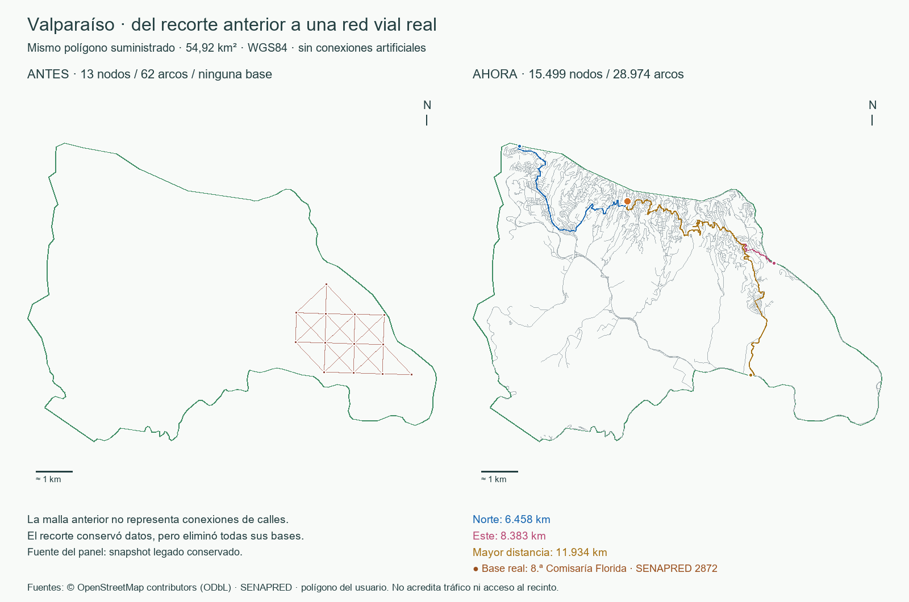

# Verificación y reconstrucción vial de Valparaíso

Fecha de ejecución: 17 de octubre de 2026. La aplicación está implementada y
verificada en Docker con una red de calles reales. Esta verificación sustituye
la conclusión anterior basada únicamente en recortar la malla de fase 1.
Los PDF originales se conservan como antecedentes; este informe documenta el
estado nuevo del repositorio y sus límites comprobados.

## Resultado

| Comprobación | Resultado observado |
|---|---:|
| Área del GeoJSON suministrado, EPSG:32719 | 54,920709 km² |
| Nodos viales físicos | 15.499 |
| Arcos dirigidos | 28.974 |
| Nodos / arcos fuera del polígono | 0 / 0 |
| Nodos aislados / arcos con extremos inválidos | 0 / 0 |
| IDs de nodos duplicados / claves de nodo duplicadas | 0 / 0 |
| IDs de arco duplicados / pares dirigidos duplicados | 0 / 0 |
| Arcos sin procedencia OSM / transiciones inválidas | 0 / 0 |
| Nodos alcanzables desde el origen vial | 13.249 |
| Nodos no alcanzables desde ese origen | 2.250 |
| Componentes débiles / fuertes | 109 / 1.459 |
| Pruebas finales en Docker | 74 aprobadas; 0 fallos, errores u omisiones |

Fuentes de estas cifras: [auditoría espacial](auditoria_espacial.json),
[validación de la BD](validacion_bd.json), [suite final](pruebas_finales.json)
y [log de las pruebas](pruebas_finales.log). Son resultados sobre una instantánea,
no una certificación de circulación actual en terreno.



## Base real seleccionada

Se utiliza la **8.ª Comisaría Florida**, registro `objectid=2872` del catálogo
**SENAPRED Servicios_2024, CARABINEROS, capa 3**. Su geometría original es
`[-71.621817, -33.0531369999999]`, en orden longitud/latitud WGS84. La presentación
web redondea la latitud a `-33.053137`.

La [Municipalidad de Valparaíso, Valpo Seguro](https://municipalidaddevalparaiso.cl/valposeguro/)
corrobora la instalación y el domicilio **Mariana Sarraeta 136, Cerro Florida**.
Se conserva esa grafía de la fuente; la calle OSM se denomina Mariano Sarratea.
La página institucional descargada y su hash están en
`datos/entrada/vial/corroboracion_municipal.html` y su JSON asociado.
La fuente de coordenadas es SENAPRED, no una geocodificación inventada del domicilio.

La instalación está dentro del polígono. Se mantiene separada del nodo OSM real
**13049981860**, `[-71.6217814, -33.0531793]`, ID interno
`8716049048730704023`, donde comienza Dijkstra. La distancia entre ambos puntos,
medida en PostGIS/UTM 19S, es **5,752035686 m**. No se añade un arco ficticio entre
ellos ni se incluye ese acceso interior en el costo mostrado. El punto del
catálogo tampoco acredita por sí solo la posición exacta de una entrada vehicular.

La selección es un **origen geográfico de referencia para ruteo**. No acredita
autorización de uso de instalaciones policiales ni una operación institucional.
El criterio configurable exige pertenencia al área, un nodo vial existente a
menos de 30 m y al menos 1.000 nodos alcanzables. El último umbral es un control
de utilidad del proyecto, no un estándar oficial ni una medida de seguridad.

Se evaluaron cinco instalaciones dentro del límite: una de Bomberos y cuatro
de Carabineros. Las cuatro policiales tienen conectividad útil; Florida cuenta
además con corroboración municipal conservada y queda a 5,75 m de la red.
No se afirma que sea una ubicación óptima para despliegue de recursos.

**Alternativa descartada:** la Décima Sexta de Valparaíso, Bomberos 104, Laguna
Verde, sí es real y está dentro del área. Su nodo vial próximo queda a 14,25 m,
pero el polígono corta sus conexiones: solo alcanza **15 nodos**, con un recorrido
máximo de **0,098288 km**. Se descartó sin ampliar el límite ni inventar enlaces.
La [fuente institucional de Bomberos](https://www.bomberos.cl/contenidos/home-noticias/decimosexta-compania-de-bomberos-de-valparaiso-inauguro-su-nuevo-cuartel)
y la comparación están conservadas. [Evaluación reproducible de las bases](evaluacion_bases.json).

## Fuentes y trazabilidad

| Insumo | Procedencia y corte conservado |
|---|---|
| Límite | GeoJSON exacto proporcionado por el usuario; no se sustituye por el límite administrativo de toda la comuna. |
| Calles y restricciones | OpenStreetMap vía Overpass, `https://overpass-api.de/api/interpreter`; base OSM del 17-10-2026 a las 15:10:06 UTC. |
| Instalaciones | Servicio público SENAPRED `Servicios_2024/FeatureServer`, capas 1 (BOMBEROS) y 3 (CARABINEROS). |
| Identidad y domicilio de la base | Página oficial municipal citada arriba, descargada el 17-10-2026. |

Las URLs completas de ArcGIS, consultas Overpass, códigos HTTP, fechas, tamaños,
licencia ODbL y SHA-256 están en
[manifest.json](../../datos/entrada/vial/manifest.json). Los originales conservan
las coordenadas, IDs, versiones y etiquetas del proveedor. El año del producto
SENAPRED y los atributos históricos no se presentan como una inspección en 2026.
No se presume una licencia para SENAPRED que no esté declarada por el servicio.

Hashes de referencia:

```text
AOI:         7d3a0472f2e7fdde88d6316f89c31d6da50914e06cabb6bf8bd270ce54c905b7
OSM inicial: 96e2bc8e79083e9746d102a01f27645e25ded9e8d97f7c7bf09bb0eecf437a6b
Bomberos:    b128bf965d269ea1c5c5513a40cebaf1498ab5bafcc6110e942a76d70bcb010c
Carabineros: deae518a3d64c6c2e43615544f216fdaba7cf818a782abd8ded101ab2a1bd406
Salida vial: 7180d631f22aa6dee76759d2a857856cf4e0355de78ae811a48154baf4384197
```

La segunda descarga online tuvo corte OSM **22:12:20 UTC**. Cambió el hash de la
respuesta y el run, pero produjo los mismos conteos y rutas. Su manifiesto está
en [manifest_online.json](manifest_online.json); el original
`osm_0cebf8a03042ae41.json` también se conserva en `datos/entrada/vial`.
El manifiesto activo permanece fijado al primer corte para reproducirlo.

## Cómo se reconstruye la red

1. Se solicita la envolvente del área para descargar vías, nodos completos y
   relaciones de restricción. La envolvente sirve para adquisición; la
   pertenencia final se decide con el polígono real.
2. Se conservan únicamente clases viales compatibles con vehículo liviano. Se
   excluyen escaleras, senderos, vías peatonales y accesos no admitidos por el
   perfil. Se respetan sentidos explícitos, sentidos inversos, rotondas,
   restricciones por dirección y barreras conocidas. Condiciones y dimensiones
   que el perfil no puede resolver se excluyen; giros relevantes no soportados
   provocan error explícito.
3. Cada arco une **dos nodos consecutivos de la vía OSM original**. Se conservan
   sus vértices de forma. Solo los nodos OSM compartidos crean conexiones; un
   cruce visual de puentes o calles próximas no genera una intersección nueva.
4. Ambos extremos y el segmento completo deben estar cubiertos por el límite.
   Se descartan segmentos parciales; no se fabrican extremos en la frontera.
   Esto puede dejar pequeños tramos y componentes separados, que se conservan.
5. Se generan IDs estables, se rechazan colisiones y se deduplican los pares
   dirigidos. Cada arco conserva vía, índice de segmento, nodos y etiquetas OSM.
   El cargador contrasta nuevamente toda esa procedencia antes de aceptar datos.
6. Se transforma a EPSG:32719 para medir longitudes en metros y guardar geometrías.
   El costo es exclusivamente `ST_Length(geom)/1000`, en kilómetros.

La pertenencia se verifica en **EPSG:4326, mediante ST_Covers, sin buffer**.
La reproyección de los segmentos rectos del anillo cambia su interpolación entre
vértices. Una comprobación sobre el anillo transformado causaba dos exclusiones
aparentes; se corrigió usando el GeoJSON WGS84 como límite autoritativo. No se
deformó el área para que pasara la prueba.

La instantánea aplica **29 relaciones de giro**, que generan 29 secuencias
prohibidas: 28 de dos arcos y una de tres arcos con vía intermedia. Otras 58
relaciones se documentan como ajenas a los segmentos retenidos o al perfil.
Un autómata de prefijos utiliza 28.975 estados y 58.629 transiciones para recordar
esos giros. Son estados de algoritmo, no nodos físicos agregados al mapa.

`routing.road_path` ejecuta **pgr_dijkstra** sobre ese grafo y devuelve la cadena
de arcos originales. Las longitudes se suman una vez por arco recorrido y se
contrastan con el costo agregado de pgRouting. La referencia clásica sin giros
sigue disponible para comparación interna; la interfaz usa la consulta con giros.

## Rutas observadas y pruebas

| Ejemplo | Destino WGS84 [lon, lat] | Distancia vial | Arcos |
|---|---|---:|---:|
| Norte | [-71.6535036, -33.0396646] | 6,458462519 km | 343 |
| Este | [-71.5789074, -33.0683943] | 8,382925758 km | 626 |
| Mayor distancia alcanzable | [-71.5857006, -33.0958246] | 11,933608317 km | 779 |

[Ruta Norte](ruta_1.geojson), [ruta Este](ruta_2.geojson) y
[ruta de mayor distancia](ruta_3.geojson) contienen geometría, costos e IDs
de todos los arcos. Son tres destinos distintos, no tres alternativas al mismo
destino ni evidencia de resiliencia frente a amenazas.

Las 74 pruebas incluyen las regresiones de SQL, contratos, topología, protección
de migraciones, publicación atómica, permisos de lectura y repetición. Los nuevos
casos contrastan procedencia OSM, base real, límites, duplicados, accesos,
sentidos, barreras, cruces sin unión, giros y rutas. Un Dijkstra independiente,
implementado con `heapq` en Python sobre las transiciones de la BD, coincide con
pgRouting para los tres destinos, a nueve decimales de kilómetro.

El destino real `2648934237786465`, fuera del conjunto alcanzable, se rechaza con
un error claro. La API también devuelve HTTP 422 para coordenadas fuera del
polígono y destinos mal formados. Seleccionar el punto del origen OSM devuelve
el mismo nodo, con separación numérica inferior a 1 mm.

Se verificó Leaflet en navegador sobre Docker: carga de la red local, selección
de destinos y ruta Este de **8,383 km / 626 arcos**, sin errores ni avisos en
consola. [Captura de la interfaz](interfaz_ruta.png). Leaflet y sus estilos están
conservados localmente; las teselas de fondo externas son opcionales y empiezan
desactivadas.

## Docker, integración y reproducción

Entorno efectivamente ejecutado: **Python 3.12.12, PostgreSQL 16.9,
PostGIS 3.5.2 y pgRouting 3.8.0**. Las imágenes y dependencias están fijadas por
digest/hash. El host solo requiere Bash y Docker; la BD no publica puerto y la
web usa un rol de lectura.

Se ejecutó `main` con dos proyectos nuevos y volúmenes vacíos, sin salidas
derivadas anteriores. Se reutilizó la caché de imágenes/dependencias de Docker;
no se simuló un sistema operativo recién instalado.

| Ejecución | Resultado y evidencia |
|---|---|
| Snapshot, BD vacía, `udp-ruteo-valpo-limpio` | Ready, run `4718c905-d0bf-52bf-a82b-33525cc936fd`; ET/carga/auditoría 50,185 s. [Resumen](arranque_limpio.json), log asociado. |
| Repetición del mismo snapshot | Mismo run, `idempotent=true`, 44.473 entidades sin duplicados. [Resumen](repeticion.json). |
| Online, BD vacía, `udp-ruteo-valpo-online` | Descargas HTTP 200, ET/carga/auditoría 47,684 s, web saludable; run `371f830e-c03b-540f-9ad7-2de0d26590e0`. [Resumen](arranque_online.json), log asociado. |
| API de ambas instancias | Cinco controles HTTP por instancia, todos correctos. [Snapshot](http_snapshot.json), [online](http_online.json). |
| Suite final separada en tmpfs | 74/74, 218,023 s; ninguna prueba omitida. [Resultados](pruebas_finales.json). |

Los tiempos de la tabla son del pipeline, excluyen construcción de imágenes e
inicio de servicios. La instancia online temporal se detiene después de capturar
evidencia; queda disponible la instancia snapshot en **http://127.0.0.1:18081**.

Desde Bash, para una instalación normal:

```bash
./main probar
./main                         # originales fijados: no consulta proveedores
./main iniciar --mode online    # nueva adquisición real y nuevo run
./main estado
./main detener                 # conserva volúmenes
```

Para operar la instancia de validación que quedó habilitada:

```bash
COMPOSE_PROJECT_NAME=udp-ruteo-valpo-limpio WEB_PORT=18081 ./main estado
COMPOSE_PROJECT_NAME=udp-ruteo-valpo-limpio WEB_PORT=18081 ./main
COMPOSE_PROJECT_NAME=udp-ruteo-valpo-limpio WEB_PORT=18081 ./main detener
```

El SQL inicial permanece intacto. La migración `002_red_vial.sql` agrega tres
tablas y extensiones compatibles, llevando el modelo a **25 tablas**.
[Diagrama ampliado](../../BD/diagrama_vial.svg). `main` crea el esquema completo
desde cero y omite migraciones ya aplicadas, verificando sus hashes. La
configuración antigua y sus originales se conservan para regresiones.

Para regenerar pruebas y mapas adicionales, consultar
[README de evidencias](README.md). No se requiere ninguna credencial de proveedor
para las fuentes públicas utilizadas. Un error de descarga o contrato aborta la
nueva publicación y conserva la anterior.

## Límites materiales y pendientes

- La red representa la cartografía disponible en OSM y el polígono recibido.
  No garantiza exactitud completa de señalización, sentidos o accesos actuales;
  no incorpora tráfico, cierres ni comprobación en terreno.
- No se modela el acceso de 5,75 m entre el punto SENAPRED y la calle. Por tanto,
  la distancia presentada comienza en el nodo OSM, no en una puerta verificada.
- Los 2.250 nodos no alcanzables y los 109 componentes débiles son parte del
  diagnóstico. No se inventan puentes, uniones por cercanía ni viajes fuera del
  área. El corte estricto también descarta tramos de calle que cruzan su frontera.
- Esta adaptación implementa **ruteo terrestre para vehículo liviano**. No
  convierte los corredores aéreos anteriores en calles ni acredita los modelos
  de vuelo, amenazas o resiliencia del planteamiento original.
- Los ocho ETL grupales de metadata/amenazas, las alternativas al mismo destino
  y la evaluación de resiliencia continúan pendientes. `phase2_complete=false`
  evita presentar esa parte del trabajo grupal como terminada.

Se conserva también un resultado preliminar fallido y una corrida anterior de
72 pruebas para trazabilidad. **La evidencia vigente es `pruebas_finales.json`**;
los intentos previos no se contabilizan como validaciones exitosas.
