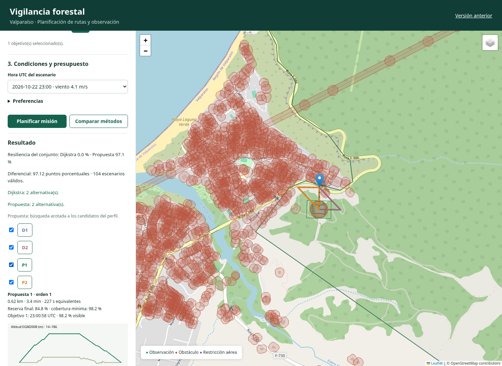

# Vigilancia territorial: implementación y evidencia

Publicación verificada: `ec99211d-6781-5076-9294-c7b52641c5fc`. Base conservada: `b80f9b83-cad7-53b8-a8b8-34a2a17e614c`.

El planificador incorpora una red adaptativa de estados tridimensionales, obstáculos, meteorología ampliada, observación geométrica y patrullas de uno a tres sectores obligatorios con orden automático. La migración y las APIs nuevas mantienen las instantáneas y contratos anteriores.

## Resultado de la construcción

| Componente | Resultado |
|---|---:|
| Anclas territoriales | 5.834 |
| Anclas refinadas a 125 m | 5.694 |
| Estados de vuelo | 17.502 |
| Enlaces dirigidos geométricos | 342.970 |
| Enlaces admitidos por superficie y obstáculos estáticos | 192.720 |
| Anclas omitidas por NoData | 0 |
| Obstáculos OSM | 25.483 |
| Obstáculos con altura declarada | 422 |
| Horas meteorológicas | 168 |
| Productos JSON de infraestructura, metadata y amenazas | 11 |

La auditoría detectó cero estados fuera del área, cero enlaces fuera del área y cero inconsistencias entre extremos. La red geométrica tiene una componente fuertemente conexa. Esa conectividad precede a las restricciones de cada misión y no demuestra que todas sean viables. Los conteos completos, versiones y hashes están en [publicacion.json](publicacion.json).

La construcción desde un volumen vacío obtuvo exactamente el mismo run, hash de entradas y conteos. La repetición devolvió `idempotent=true`. Evidencia: [publicación limpia](volumen_vacio/publicacion.json), [construcción](volumen_vacio/reconstruccion.txt) e [idempotencia](volumen_vacio/idempotencia.json). Se detuvo el servicio de comprobación y se conservó su volumen `udp-ruteo-vigilancia-clean_pgdata`.

## Referencia anterior

Antes de modificar el modelo, las 128 pruebas iniciales pasaron. Las 120 solicitudes originales reprodujeron 120 resultados sin diferencias y conservaron 13 misiones propuestas viables. [Pruebas iniciales](baseline_pruebas.json) y [reproducción](baseline_replay.json). El lote nuevo tiene otra definición y no se usa para afirmar una mejora porcentual frente a esas 120 solicitudes.

## Ejemplo de un objetivo y cuatro trazas

La solicitud de interfaz conserva el lanzamiento explícito próximo a Laguna Verde y el objetivo exacto. La instalación permanece en su ubicación original. La separación del lanzamiento respecto de la instalación es aproximadamente 92,15 m. La hora de demostración es admisible dentro del pronóstico conservado. Esta selección se distingue del lote sin filtrar.

| Alternativa | Distancia completa | Evaluación | Cobertura mínima | Reserva final |
|---|---:|---|---:|---:|
| D1 | 0.376 km | surface_clearance | — | — |
| D2 | 0.551 km | obstacle_intersection | — | — |
| P1 | 0.623 km | Completa | 98.21 % | 84.84 % |
| P2 | 0.585 km | Completa | 87.68 % | 85.24 % |

Dijkstra conserva distancia 3D en km como único costo. D2 examina exclusiones individuales de arcos de D1. Cuando esas exclusiones producen solo cambios de altitud, se excluyen las copias de un corredor horizontal para buscar un desvío físico, conservando `pgr_dijkstra` y el mismo costo. La propuesta usa Yen mediante `pgr_KSP` sobre el grafo admitido, y verifica observación, consumo y regreso.

El ejemplo produce resiliencia del conjunto de 0 % para Dijkstra y 97,1154 % para la propuesta, un diferencial de 97,1154 puntos porcentuales sobre 104 escenarios. Dijkstra parte de recorridos que incumplen restricciones, por lo que la diferencia refleja también factibilidad. No acredita superioridad general de Yen. Los dos recorridos propuestos sobreviven en los mismos escenarios de este ejemplo, de modo que tener dos no aumenta aquí la supervivencia respecto de una sola alternativa.

Evidencia: [comparación real](comparacion_1.json), [solicitud exacta de interfaz](solicitud_interfaz.json), [exportación exacta](exportacion_interfaz.json), [integridad de hashes](integridad_evidencia.json) y [verificación del navegador](interfaz.json). El navegador comprobó cuatro trazas distintas, perfil, capas individuales, exportación, invalidación tras cambiar preferencias, descarte de respuestas tardías y disposición móvil.



Las capturas con encuadre estabilizado reutilizan las respuestas HTTP ya verificadas, sin alterar sus rutas o métricas. [Procedencia de capturas](capturas.json).

## Patrulla de tres objetivos

Los tres sectores son obligatorios. La demostración calcula dos patrullas completas sin eliminar objetivos.

| Opción | Orden | Observaciones | Duración | Consumo equivalente | Reserva final |
|---|---|---:|---:|---:|---:|
| P1 | 3 → 1 → 2 | 3 | 361.87 s | 388.46 s eq | 74.10 % |
| P2 | 1 → 3 → 2 | 3 | 361.87 s | 388.46 s eq | 74.10 % |

La verificación adicional del navegador seleccionó tres sectores, rechazó un cuarto conservando la selección y obtuvo dos patrullas mediante HTTP con observación de los tres sectores y regreso. [Solicitud](solicitud_3.json), [resultado ETL](mision_3.json), [resultado HTTP](mision_3_interfaz.json) y [prueba de interfaz](patrulla_interfaz.json).

## Lote fijo de evaluación

El [plan de nueve casos](lote/plan.json) se escribió antes de calcular resultados. Fija un lanzamiento explícito y los tres puntos de vegetación más próximos, para misiones de 1, 2 y 3 objetivos. Usa las horas primera, central y penúltima posteriores a la adquisición sin filtrar meteorología. Incluye un sector centrado en el lanzamiento. Los resultados tienen alcance exploratorio local.

| Objetivos | Casos | Casos con métrica definida | Casos con dos propuestas | Diferencial medio |
|---|---:|---:|---:|---:|
| 1 | 3 | 3 | 1 | 32.3718 pp |
| 2 | 3 | 3 | 1 | 32.3718 pp |
| 3 | 3 | 3 | 1 | 32.3718 pp |

Cada caso congela las misiones antes de aplicar 100 cierres espaciales y cuatro sensibilidades ambientales comunes. No hay replanificación dentro de la supervivencia. Se publican las familias por separado y los desconocidos comparten denominador. Un resultado positivo, cero o negativo es válido. El resumen no representa una probabilidad de operación segura. [Resumen](lote/summary.json).

## Pesos y reglas comprobables

Los [ejemplos de arcos reales](pesos.json) muestran un arco sin penalización, otro penalizado y exclusiones por obstáculos y despeje. El arco con despeje de 57,3948 m tiene riesgo 0,565129, tiempo equivalente 27,6210 s y costo 43,2305 s penalizados. Los excluidos no reciben un costo finito para la propuesta.

La ventana meteorológica completa considera viento a 10/100 m, rachas, lluvia, temperatura y visibilidad. El consumo suma ascenso, observación por objetivo, cambios de dirección y regreso. La referencia genera sus rutas sin amenazas ni preferencias y se evalúa después. La recurrencia se conserva como contexto y cobertura ponderada, sin penalizar por defecto el acercamiento.

La [sensibilidad del ascenso](sensibilidad_ascenso.json) mantiene las trayectorias y cambia el factor a 1,25, 1,5 y 2. Para P1 de un objetivo, el consumo pasa por 214,29, 227,40 y 253,64 s equivalentes, respectivamente. Esta comparación no calibra una batería ni replanifica rutas.

## Verificación final y reproducción

La suite final aprobó **154 pruebas**, con cero fallos, errores u omisiones, en 467.573 s. [Resultado](pruebas.json) y [registro](pruebas.txt). Las 26 pruebas nuevas cubren reglas del perfil, geometría, relieve intermedio, NoData, oclusión, viento, energía, objetivos múltiples, referencia invariante, alternativas físicas, escenarios congelados y datos desconocidos. Las pruebas de navegador están registradas por separado.

Una repetición detectó reutilización de la base temporal entre corridas. `./main probar` ahora usa `--force-recreate` para que el tmpfs de la base y el contenedor de archivos empiecen juntos. Esta corrección no afecta la base principal.

```bash
./main
./main probar
./main vigilancia evaluar --request evidencia/vigilancia_2026-10-22/solicitud_interfaz.json
./main vigilancia evaluar --experiment config/evaluacion_vigilancia.json
```

La adquisición nueva es explícita mediante `./main vigilancia adquirir`. `./main vigilancia preparar` vuelve a construir y cargar los once productos si cambian entradas o constructor. [Guía y API](../../docs/VIGILANCIA.md), [diccionario](../../docs/DICCIONARIO_VIGILANCIA.md), [SQL](../../BD/migraciones/005_vigilancia.sql), [diagrama](../../BD/diagrama_vigilancia.svg) y [matriz de rúbrica](../../presentacion/MATRIZ_VIGILANCIA.md).

## Supuestos técnicos y límites

El perfil no corresponde a una aeronave ni cámara caracterizadas. Usa segundos equivalentes de consumo y geometría de observación, sin atribuir sensibilidad de detección real. DSM y OSM no resuelven todos los obstáculos. Solo 422 objetos tienen altura declarada y el sistema no convierte pisos en metros observados. IFS HRES de 9 km no representa variaciones meteorológicas entre cerros. FIRMS y AIP conservan las fechas de su instantánea anterior. La ruta no constituye autorización aeronáutica. Comunicaciones, plataforma de lanzamiento y condiciones en terreno requieren verificación operativa.

La búsqueda usa hasta diez caminos por tramo, cincuenta estados parciales y doce anclas cercanas para conectar extremos. No demuestra óptimo global ni imposibilidad de vuelo continuo cuando no encuentra una misión. Las consultas y comparaciones pueden tardar varios minutos sobre la red completa. No se agregó control de aeronaves ni detector de imágenes.

La presentación editable reúne 24 diapositivas y la matriz localiza los 60 puntos sin anticipar la calificación. La publicación en Git queda a cargo del usuario.
